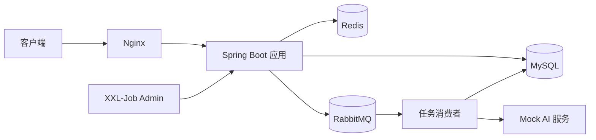
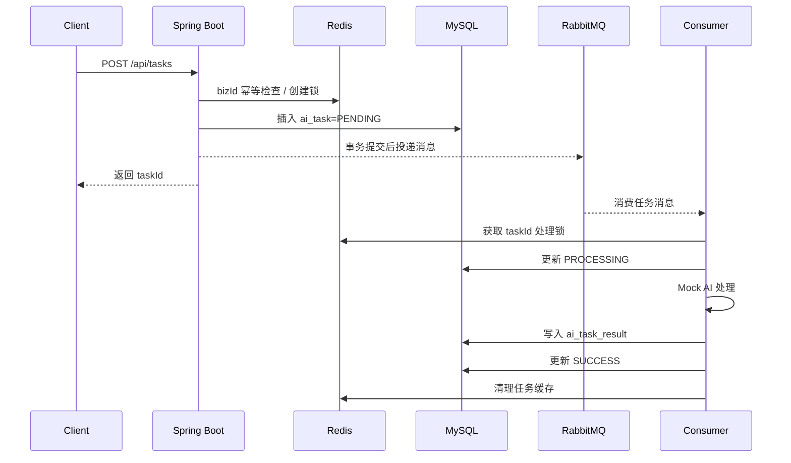

# 架构说明

## 系统架构

系统核心不是 AI 算法，而是一个典型的“任务提交、异步执行、状态管理、结果查询、失败补偿”后端平台。

## 核心流程

## MQ 设计

- Exchange：`ai.task.exchange`
- Queue：`ai.task.queue`
- RoutingKey：`ai.task.execute`
- DLX：`ai.task.dlx`
- DLQ：`ai.task.dlq`

创建接口只负责参数校验、幂等控制和任务落库，不同步等待 AI 处理。任务消息进入 RabbitMQ 后，由消费者异步处理。

## Redis 设计

| Key | 作用 | TTL |
| --- | --- | --- |
| `ai-task:create-lock:{bizId}` | 创建任务并发锁 | 30 秒 |
| `ai-task:biz-task:{bizId}` | bizId 到 taskId 的幂等映射 | 6 小时 |
| `ai-task:task-detail:{taskId}` | 任务详情缓存 | 10 分钟 |
| `ai-task:task-result:{taskId}` | 成功任务结果缓存 | 30 分钟 |
| `ai-task:process-lock:{taskId}` | 消费端处理锁 | 5 分钟 |

缓存策略是 Cache Aside：读时先查缓存，未命中查 DB 并回写；任务状态变化时删除相关缓存。

## 幂等设计

创建任务：

1. 先查 Redis `biz-task`，命中则直接返回已创建任务。
2. 未命中再查 MySQL `uk_biz_id`，避免 Redis 丢失导致重复创建。
3. 获取 Redis `create-lock`，防止同一 `bizId` 并发创建。
4. MySQL 唯一索引作为最终兜底。

消费任务：

1. 先获取 Redis `process-lock`。
2. 查询任务状态，成功任务直接跳过。
3. 查询结果表，已有结果直接跳过。
4. 结果表 `task_id` 唯一索引兜底。

## 事务与一致性

任务创建时先在事务内写 `ai_task` 和 `ai_task_log`，事务提交后才发送 RabbitMQ 消息。这样可以避免“消息已经被消费，但任务记录因为事务回滚不存在”的问题。

严格生产环境可以进一步演进为 Outbox 表：事务内写业务表和消息表，再由独立任务扫描消息表投递 MQ。本项目为了保持适合校招讲解，没有引入过多复杂度。

## 定时任务设计

项目提供两个任务方法，同时支持本地 `@Scheduled` 和 XXL-Job：

- `markTimeoutAiTaskJob`：扫描长时间处于 `PROCESSING` 的任务，标记为 `FAILED`。
- `retryFailedAiTaskJob`：扫描失败且未超过最大重试次数的任务，更新为 `PENDING` 并重新投递 MQ。

这样系统即使遇到消费者异常、应用重启或中间件短暂抖动，也有补偿能力。

## 数据库设计

- `ai_task`：任务主表，保存任务状态、幂等 bizId、重试次数和失败原因。
- `ai_task_result`：结果表，按 `task_id` 唯一约束防止重复写结果。
- `ai_task_log`：任务事件日志，记录创建、处理、成功、失败、重试等关键节点。
